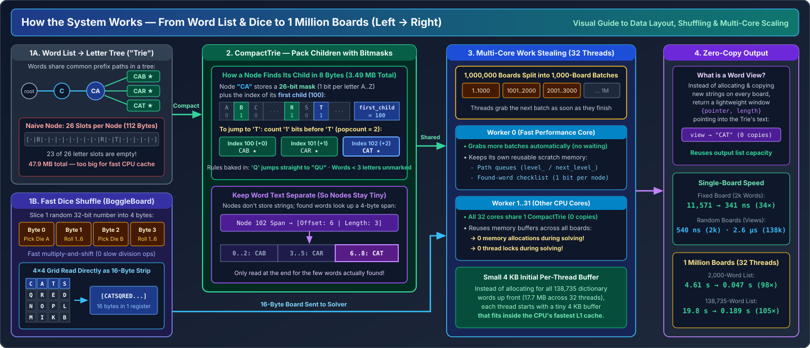
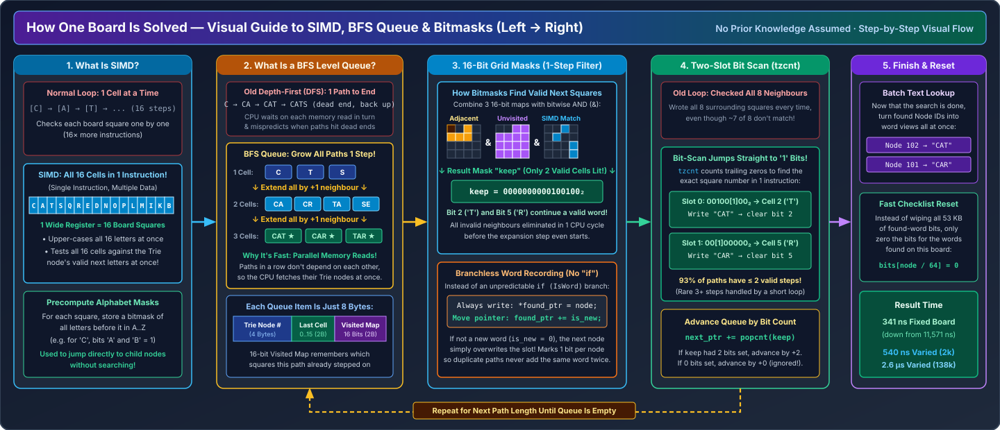
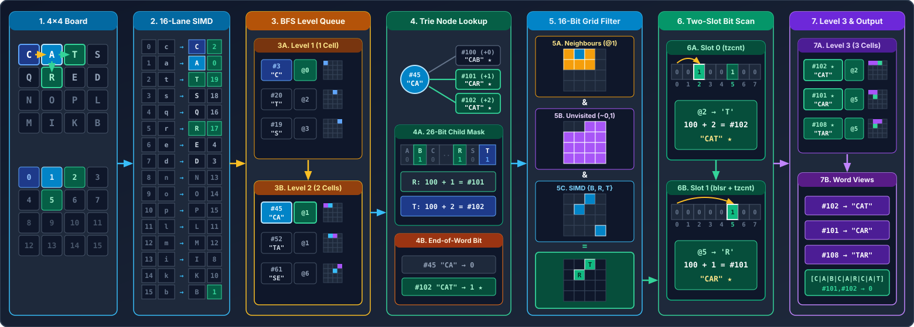

# Architecture

[Project overview](../README.md) · [Documentation index](README.md)

## Components

- **Dictionary**: A trie structure optimized with a vector-based allocation to ensure contiguous memory layout. Words can be inserted at any time.
- **CompactTrie**: A read-only copy of the Dictionary built for solving. Nodes are 8 bytes with their children stored next to each other, word text spans are packed into 4 bytes (`(offset << 8) | length`), a 1,728-byte L1-resident 2-letter lookup table (`pair_nodes_[27][32]`) maps every valid two-letter prefix straight to its depth-2 node (pruning dead depth-2 leaves and mapping invalid cells to 0), and the Boggle rules ("Q" reads as "QU", words need 3+ letters) are folded in when it is built. One copy can be shared by solvers on several threads.
- **BoggleBoard**: Mimics standard die configurations stored in a flat lookup table; uses an inline 32-byte `Xoshiro256++` PRNG (seeded via SplitMix64) and a compile-time-unrolled single-pass Fisher-Yates shuffle and die-face roll consuming four 64-bit draws per board with zero divisions, stores the board flat in a 16-byte aligned array (`sizeof(BoggleBoard) == 64` bytes), and handles ASCII output. Can be seeded for a reproducible sequence of boards.
- **BoggleSolver**: Core search engine. It seeds the breadth-first queue directly at depth 2 via `CompactTrie::GetPairNodeTable()` (falling back to depth 1 only for custom tries with 1-cell words) and packs every path into a single 64-bit integer (`PackedPath`: 32-bit node, 16-bit last cell, 16-bit visited mask). Each level runs a decoupled two-phase branchless pipeline: **Phase A** loads trie nodes through hoisted `__restrict` pointers, records candidate word hits branchlessly without touching `found_word_bits_` (deferred deduplication), filters matching board cells in 128-bit SSSE3 (`_mm_add_epi8(..., 127)` + `_mm_movemask_epi8`, or a `letter_cells` bit-scan fallback on non-SSSE3 targets), and drops ~54% dead-end paths before queuing surviving paths into `active_`; **Phase B** drains `active_` with a multi-pass branchless 2-slot `tzcnt`/`blsr` compaction loop using a `constexpr` `CELL_PACKED` table for single 64-bit writes. After searching, a compact branchless bitset pass deduplicates candidate word hits and emits views via a zero-`memset` random-access `WordViewIterator` (`SolveInto`) or in-place owned `std::string`s (`Solve`).

## Visual overview

### System architecture, memory layout, and multi-thread pipeline

### Single-board search pipeline and inner-loop optimizations

### Step-by-step single-board solve walkthrough

## Data flow

1. The [console application](../src/main.cpp) loads a word list into `Dictionary`.
2. `BoggleSolver::BuildTrie` creates an immutable `CompactTrie` snapshot (including the 2-letter `pair_nodes_` table). Later inserts into the source dictionary do not update that snapshot.
3. `BoggleBoard` supplies a flattened 4×4 grid of letters shuffled inline with `Xoshiro256++`.
4. `BoggleSolver` seeds depth-2 paths directly from the 84 board edges, then runs the decoupled Phase A (filter + deferred word recording) / Phase B (branchless 2-slot expansion) breadth-first loop.
5. After searching, a branchless bitset pass deduplicates the recorded word candidates, reads word text into owned strings or views, and clears only the touched 64-bit bitset blocks.

Each worker owns its board, solver, and mutable search buffers while sharing the immutable trie. In the million-board challenge, the calling thread runs worker 0 directly alongside `N - 1` `std::jthread` workers fed by a cache-line-aligned relaxed atomic counter with single-op guided dynamic chunking (`256..2048` boards) and SplitMix64-derived per-worker seeds. See [API usage and view lifetimes](usage.md) and the [optimization history](optimization-history.md) for the implementation's evolution.

## Source layout

| Path | Purpose |
|:---|:---|
| [src/Dictionary](../src/Dictionary) | Mutable dictionary and compact solving trie |
| [src/BoggleBoard](../src/BoggleBoard) | Dice, board generation, and display |
| [src/BoggleSolver](../src/BoggleSolver) | Search and result collection |
| [test](../test) | GoogleTest unit tests |
| [benchmark](../benchmark) | Google Benchmark fixtures and recorded results |
