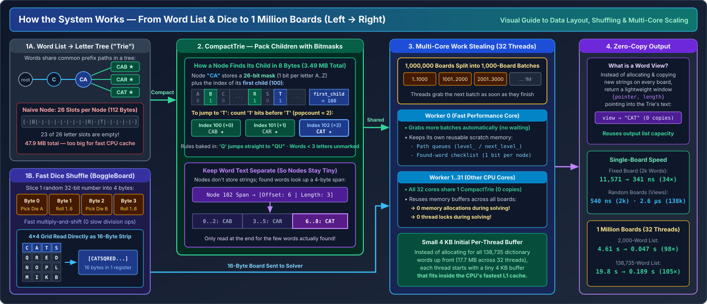
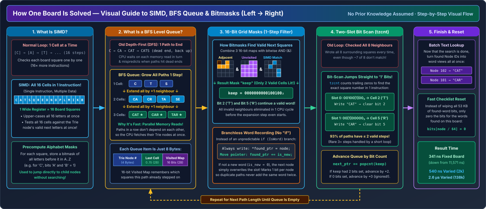
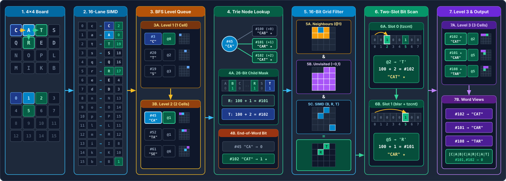

# Optimization history

[Project overview](../README.md) · [Documentation index](README.md)

Historical measurements describe the implementation and test suite at each stage. See [benchmarking](benchmarking.md) for current benchmark modes and interpretation.

## Visual summary of optimization methods







- The benchmarks have been ran on a Windows 11 machine with an 13th Gen Intel(R) Core(TM) i9-13900HX (2.20 GHz).
- The benchmarks ran use the `basic_english_words_2000.txt` word list file to build the dictionary (hard-coded).
- The benchmarks repeats the benchmark fixture 50 times to determine the mean time.
- The baseline (solving the problem, no performance refactoring) execution time has been witnessed to be approximately 11,500 nanoseconds per solve.
- Throughout the development, constant refactoring and performing trial and error investigations has led to the current performance improvements over time.
- The before and after mean execution times are measured using the [Google Benchmark suite](https://github.com/google/benchmark.git).

|Step |Improvement | Description | Before  | After | % Gain |
|:--- |:--- | :--- | :--- | :--- | :--- |
|1 |**Vector Allocation** | Replaced heap-allocated Trie nodes with a contiguous `vector arena`. | 11,571ns | 9,789ns | ~15% |
|2 |**Char Case Optimization** | Switched search to uppercase to eliminate runtime `std::tolower` calls. | 9,789ns | 5,752ns | ~41% |
|3 |**Container Choice** | Moved from `std::set` to `std::vector` for result tracking. | 5,752ns | 5,011ns | ~13% |
|4 |**Precomputing** | Used bitmask and precomputed neighbour lists to remove branch overhead. | 5,011ns | 3,985ns | ~20% |
|5 |**Word Traverse** | Replaced full-tree re-scans with incremental $O(1)$ node index tracking. | 3,985ns | 3,196ns | ~20% |
|6 |**Precompute Refactor**| Shifted precomputed neighbour calculation to compile-time `constexpr`. | 3,196ns | 3,039ns | ~5% |
|7 |**String Buffer** | Eliminated heap allocations by using a reference-passed string buffer. | 3,039ns | 2,745ns | ~10% |
|8 |**Duplicate Words**| Added `solve_id` tracking to skip redundant word processing. | 2,745ns | 2,572ns | ~6% |
|9 |**Inlining Functions**| Made `GetNextNodeIndex` and `IsWord` inline to reduce function calls. | 2,572ns | 2,536ns | ~1.4% |
|10 |**Reserve String Size**| Reserve the memory for `current_word_buffer_` to reduce malloc calls. | 2,536ns | 2178ns | ~14% |
|11 |**Local Lambda**| Moved the recursive DFS function to a local lambda to reduce function calls. | 2178ns | 1918ns | ~12% |
|12 |**Bitmask Children**| Changed the way we iterate and check the children nodes to a bitmask approach. | 1918ns | 1123ns | ~41% |
|13 |**Bitmask the Neighbours**| Changed the nieghbours from a struct to a bitmask approach. | 1123ns | 1051ns | ~6% |

**Total Performance Gain:** ~90% reduction in execution time (11,571ns → 1,051ns).

### Round 2: Distinct Boards & Threads

The benchmark above solves the same board over and over, which lets the CPU's branch predictor learn that board. On boards it has not seen, the step 13 solver takes about 3,400ns rather than about 1,000ns. The benchmark now cycles through 4,096 seeded boards, and also uses the 138,735-word list, whose original trie (47.9 MB) did not fit in the CPU's cache.

- Measured on a Windows 11 machine with a 13th Gen Intel(R) Core(TM) i9-13900K (24 cores / 32 threads), so the step 13 figures differ slightly from the table above.
- Single-thread figures are the median of three runs of 10 repetitions, with the old and new solvers run alternately and pinned to one performance core.

|Step |Improvement | Description | Measured | Before | After | % Gain |
|:--- |:--- | :--- | :--- | :--- | :--- | :--- |
|14 |**Seed Once**| `Shuffle()` built a `std::random_device` and `std::mt19937` and copied the dice on every call. The generator is now seeded once and an index array is shuffled in place. | `Shuffle()` alone | 1,103ns | 143ns | ~87% |
|15 |**Compact Trie**| Added `CompactTrie`: 8-byte nodes (was 112) with children stored together and found by `popcount`. "Q" → "QU" and the 3-letter minimum are folded in when it is built, and words are stored per node, so the search loop no longer handles either rule or builds a string. The 138,735-word trie shrinks from 47.9 MB to 3.4 MB. | Fixed board, 2,000 words | 1,031ns | 727ns | ~29% |
| | | | Distinct boards, 2,000 words | 3,468ns | 2,217ns | ~36% |
| | | | Distinct boards, 138,735 words | 18,515ns | 9,913ns | ~46% |
|16 |**Threads**| One solver per hardware thread, all sharing the read-only trie. Threads take boards 1,000 at a time so that faster cores do more of the work. | Boards/s, 2,000 words | 0.47 M (1 thread) | 9.20 M (32 threads) | 19.8x |
| | | | Boards/s, 138,735 words | 0.10 M (1 thread) | 2.16 M (32 threads) | 22.2x |

**Round 2 Result:** the 1 million board challenge (shuffle & solve) went from 4.61 s to 0.13 s with the 2,000-word list, and from 19.8 s to 0.50 s with the 138,735-word list.

### Round 3: Letter Masks for Single-Board Solving

Previously, each DFS step checked every unused neighbour against the trie, including letters that could not extend the current prefix. The solver now prepares two 16-byte selectors for the board. At each prefix, an SSSE3 byte shuffle and bit tests convert the trie's 26-bit child-letter mask into matching board cells. Intersecting those cells with the unused neighbours removes failed transitions before the loop. The trie keeps its 8-byte nodes, and the search visits matching cells in the same order as before.

The acceleration is enabled when the compiler target defines `__SSSE3__`, as it does on the measured machine with `-march=native`. Other targets retain the original neighbour traversal. The results below apply to the SSSE3 path.

Measured on 25 November 2026 with a 13th Gen Intel Core i9-13900K on Windows, using Clang 23.1.4 and the Release build (`-O3 -DNDEBUG -march=native`):

| Dictionary | Before | After | Time reduction | Speed-up |
|:---|---:|---:|---:|---:|
| 2,000 words | 2,226 ns | 1,519 ns | 31.8% | 1.47x |
| 138,735 words | 9,951 ns | 7,094 ns | 28.7% | 1.40x |

- Both versions ran on one thread pinned to logical CPU 2 (affinity mask `0x4`), alternating before/after for three pairs of runs. Each run used 10 repetitions with a minimum benchmark time of 0.5 seconds per repetition.
- Each version used the existing `BM_SolveRandomBoards` benchmark: 4,096 boards generated with seed 2024. The table reports the median of the three run medians from Google Benchmark's elapsed `Time` field, in nanoseconds per board. The [recorded measurements](../benchmark/results/letter_masks_2026-11-25.json) also include CPU times and variation within each run.
- Timing includes board letter preprocessing, search, and construction/destruction of the returned words. It excludes dictionary/trie loading, solver construction, and board shuffling. These figures measure single-thread solve latency over varied boards with an already constructed solver; startup and multithread throughput were not measured in this round.

To repeat the current-version measurement after a Release build, run from the repository root:

```powershell
Set-Location build/bin/benchmark/Release
(Get-Process -Id $PID).ProcessorAffinity = 0x4
.\bm_BoggleSolver_Release.exe '--benchmark_filter=BM_SolveRandomBoards/[^/]+/repeats:10$' '--benchmark_min_time=0.5s' '--benchmark_out=letter_masks.json' '--benchmark_out_format=json'
```

Validation: all 34 Release tests passed. A new independent word-by-word search checks complete result sets across 128 seeded and special-case boards, including repeated letters, `QU`, lowercase input, invalid cells, and cell reuse. All eight solver tests also passed with the solver compiled for baseline x86-64 without SSSE3, exercising the fallback.

### Round 4: Reusable Word Views

`SolveInto(board, words)` appends `std::string_view` results into a caller-owned vector after clearing it. Word characters stay in the trie, and retaining the vector between solves avoids repeated allocation once it has sufficient capacity. `Solve` remains available for owned strings. Both APIs use the same search, specialized for their output type without a temporary collection or a callback on each word. The console application now uses views, and its displayed solve time uses an explicit `std::chrono` duration in microseconds.

Measured on 25 November 2026 with the same i9-13900K, Windows, Clang 23.1.4, Release flags, and SSSE3 search as Round 3. The baseline is the previous commit (`bdba08a`), rebuilt and measured again in this session. All times are elapsed nanoseconds per board:

| Dictionary | Previous `Solve` | Current `Solve` | Views, fresh buffer | Views, reused buffer |
|:---|---:|---:|---:|---:|
| 2,000 words | 1,534 ns | 1,565 ns | 1,484 ns | 1,214 ns |
| 138,735 words | 7,594 ns | 7,312 ns | 6,522 ns | 5,942 ns |

Compared with the previous commit, a reused buffer reduces solve time by **20.9%** and **21.8%**, respectively. Fresh buffers reduce measured time by **3.3%** and **14.1%**; the smaller gain is close to normal run-to-run variation. Fresh views still allocate vector storage. The current `Solve` column records the owning API after the shared-search refactor, so its timing is visible separately from the new API's gains.

- Each column is the median of three run medians, each with 10 repetitions and a minimum benchmark time of 0.5 seconds. The runs use one thread pinned to logical CPU 2 (`0x4`) and the same 4,096 boards seeded with 2024. Current-version benchmark repetitions were randomly interleaved; baseline/current process order was reversed for the second pair.
- Fresh-buffer timings include vector construction, growth, and destruction on each iteration. Reused-buffer timings start with an empty vector, with no reserve or untimed warm-up; capacity growth is included and amortized across that run. All modes include letter preprocessing, search, and output collection, and exclude dictionary/trie loading, solver construction, board shuffling, and process startup. These measure varied boards with a prepared solver, rather than cold startup.
- The [recorded measurements](../benchmark/results/string_views_2026-11-25.json) include all run medians, CPU times, and variation. One large-dictionary baseline run had an elapsed-time outlier; all repetitions were retained and medians used.

To compare the three current output modes after a Release build, run from the repository root:

```powershell
Set-Location build/bin/benchmark/Release
(Get-Process -Id $PID).ProcessorAffinity = 0x4
.\bm_BoggleSolver_Release.exe '--benchmark_filter=BM_Solve(RandomBoards|ViewsFresh|ViewsReused)/[^/]+/repeats:10$' '--benchmark_enable_random_interleaving=true' '--benchmark_min_time=0.5s' '--benchmark_out=string_views.json' '--benchmark_out_format=json'
```

Validation: all 36 Release tests passed, including comparison of both APIs against the independent search across 128 boards. Added checks cover output order, capacity reuse, clearing stale results, null tries, and views borrowing trie text across later solves and solver destruction while a shared trie remains alive. All 10 solver tests also passed with baseline x86-64 compilation without SSSE3. The console example and its million-board challenge completed successfully.

### Round 5 — Direct lookup after letter filtering

The SSSE3 filter already confirms that each surviving neighbour has a child in the current trie node. During board preparation, the solver now builds a mask for each cell containing all letters alphabetically before its letter. During search, a `popcount` counts how many children precede that letter, giving its offset in the sorted child array. This removes a membership check from every filtered transition.

| Dictionary | Baseline (`aaa1710`) | Direct lookup | Solve time reduction |
|:---|---:|---:|---:|
| 2,000 words | 1,604 ns | 1,412 ns | 12.0% |
| 138,735 words | 6,743 ns | 6,317 ns | 6.3% |

`BM_SolveViewsFresh` measured elapsed time per board with a prepared solver and a fresh output vector. Both Release builds ran on one thread pinned to logical CPU 2 and cycled through the same 4,096 boards (seed 2024). Each figure is the median of four run medians, with 10 repetitions per run. Direct lookup was faster in all four pairs for both dictionaries. [Recorded benchmark results](../benchmark/results/known_child_2026-11-25.json)

All 36 Release tests passed. Across all 4,096 boards with each dictionary, both solve APIs returned the same words in the same order as the baseline. The scalar fallback also matched.

### Round 6 — Search one path length at a time

Counting the work showed that each trie node visited cost about 50 CPU cycles, even with the 2,000-word trie (54 KB) entirely in cache. Most of that was the CPU mispredicting how many neighbours of a cell continue the prefix, which differs at every step of a depth-first search.

The search now grows all paths by one cell per pass instead of following each path to its end. The paths of one length are kept in a flat array of `{trie node, last cell, visited cells}`. Each path writes a candidate into all eight neighbour slots and moves the write position forward only for neighbours that continue the prefix (`next_size += (keep >> cell) & 1`), so there is no branch on the neighbour count. Corner and edge cells pad their neighbour list with a cell that never matches. Within a pass, trie reads do not depend on each other, so the CPU can overlap their cache misses. The two path arrays are kept in the solver between solves.

Words are now returned shortest path first, rather than in depth-first order. `Solve` and `SolveInto` still return the same order, and the set of words found is unchanged.

| Benchmark | Dictionary | Baseline (`bbeb6ed`) | Level by level | Solve time reduction |
|:---|:---|---:|---:|---:|
| `BM_SolveViewsReused` | 2,000 words | 1,182 ns | 890 ns | 24.7% |
| `BM_SolveViewsReused` | 138,735 words | 5,761 ns | 4,129 ns | 28.3% |
| `BM_SolveViewsFresh` | 2,000 words | 1,570 ns | 1,269 ns | 19.1% |
| `BM_SolveViewsFresh` | 138,735 words | 6,593 ns | 4,957 ns | 24.8% |

Both Release builds ran on one thread pinned to logical CPU 2, alternating baseline and new builds in the order ABBAABBA, with 10 randomly interleaved repetitions of at least 0.5 seconds per run. Each figure is the median of four run medians of elapsed time per board over the same 4,096 boards (seed 2024). [Recorded benchmark results](../benchmark/results/level_search_2026-11-25.json)

All 37 Release tests passed. For 8,195 boards (the 4,096 seeded boards, each again with a lower-case and two invalid cells, plus three special boards) and both dictionaries, the sorted words matched the baseline, in both the SSSE3 build and a baseline x86-64 build that uses the scalar fallback.

### Round 7 — Found-word bits, and word text looked up after the search

To list each word once, the solver kept a 4-byte solve number for every trie node (1.7 MB for the 138,735-word trie) and looked up the word's text as soon as it was found (in a 3.4 MB array, also indexed by node). Both reads land at random places in large arrays, and happened in the middle of the search where each cache miss was paid in turn.

- Found words are now marked in one bit per trie node (53 KB for the large trie). After the search only the 64-bit blocks holding found words are cleared, so nothing is reset per board and the solve-number wrap-around is gone.
- A new word is recorded without a branch: the node is always written to a buffer of found nodes, and the count only moves on when the node ends a word that has not been found yet. `CompactTrie::GetTotalWords()` sizes that buffer.
- The text of each word is looked up after the search, in one simple loop whose reads do not depend on each other. The output vector is reserved once for the number of words found.

| Benchmark | Dictionary | Baseline (`24da2af`) | Found-word bits | Solve time reduction |
|:---|:---|---:|---:|---:|
| `BM_SolveViewsReused` | 2,000 words | 901 ns | 833 ns | 7.5% |
| `BM_SolveViewsReused` | 138,735 words | 4,166 ns | 3,598 ns | 13.6% |
| `BM_SolveViewsFresh` | 2,000 words | 1,275 ns | 899 ns | 29.5% |
| `BM_SolveViewsFresh` | 138,735 words | 5,009 ns | 3,702 ns | 26.1% |

The fresh-buffer gain is larger mainly because the output vector is now sized once instead of growing several times per solve. Measured as in Round 6 (ABBAABBA, pinned to logical CPU 2, median of four run medians). [Recorded benchmark results](../benchmark/results/found_word_bits_2026-11-25.json)

All 38 Release tests passed. The sorted words for the same 8,195 boards matched the Round 5 solver with both dictionaries, in the SSSE3 and scalar builds. Each board was solved twice in a row, checking that the found-word bits are cleared between solves.

### Round 8 — ASCII upper-casing without `std::toupper`

Board letters were upper-cased with `std::toupper`, which on Windows is a C runtime call that checks the locale, once for each of the 16 cells. ASCII upper and lower case letters differ only in bit 5, so the solver now clears that bit and checks the result is in `'A'..'Z'`. Only letters land in that range, so every other byte still maps to the letter that never has a child. A new test checks all 256 byte values.

| Benchmark | Dictionary | Baseline (`2ec3dbb`) | ASCII upper-casing | Solve time reduction |
|:---|:---|---:|---:|---:|
| `BM_SolveViewsReused` | 2,000 words | 829 ns | 800 ns | 3.5% |
| `BM_SolveViewsReused` | 138,735 words | 3,521 ns | 3,524 ns | none measured |
| `BM_SolveViewsFresh` | 2,000 words | 900 ns | 861 ns | 4.4% |
| `BM_SolveViewsFresh` | 138,735 words | 3,661 ns | 3,662 ns | none measured |

This saves about 30 ns per board, which is within run-to-run variation for the large dictionary. Measured as in Round 6. [Recorded benchmark results](../benchmark/results/ascii_upper_case_2026-11-25.json)

**Rounds 6 to 8 together**, measured directly against the Round 5 solver (`bbeb6ed`) in the same way:

| Benchmark | Dictionary | Round 5 | Round 8 | Speed-up |
|:---|:---|---:|---:|---:|
| `BM_SolveViewsReused` | 2,000 words | 1,183 ns | 804 ns | 1.47x |
| `BM_SolveViewsReused` | 138,735 words | 5,818 ns | 3,579 ns | 1.63x |
| `BM_SolveViewsFresh` | 2,000 words | 1,559 ns | 862 ns | 1.81x |
| `BM_SolveViewsFresh` | 138,735 words | 6,621 ns | 3,727 ns | 1.78x |

[Recorded benchmark results](../benchmark/results/rounds_6_to_8_2026-11-25.json)

All 39 Release tests passed, and the sorted words for the 8,195 test boards still matched the Round 5 solver with both dictionaries, in the SSSE3 and scalar builds.

### Round 9 — Two-slot bit-scan expansion, 8-byte path states, packed word spans, and division-free board shuffling

Disassembling the Round 8 solver and board shuffler highlighted bottlenecks in both single-board search and million-board throughput:

1. **Two-slot `tzcnt`/`blsr` neighbour expansion (`BoggleSolver`)**: In Round 6, each visited path wrote all 8 geometric neighbour slots from `NEIGHBOUR_LIST[path.cell]`, executing 8 `popcnt` instructions and 24 memory stores with an 8-step serial dependency chain on `next_size`. Across a Boggle search, the average number of matching neighbours (`std::popcount(keep)`) is below 1.0, ~93% of visited states have at most 2 matching neighbours, and executing 26+ stores per iteration saturated the CPU's store buffer after fewer than 3 iterations. The solver now extracts the two lowest set bits of `keep` unconditionally with `std::countr_zero` (`tzcnt`) and `keep &= keep - 1` (`blsr`)—using `lower_letters[32] == 0` when `keep == 0`—and handles the rare $\ge 3$ matching-neighbour case in an `[[unlikely]]` tail before advancing `next_ptr += std::popcount(initial_keep)`. Because `NEIGHBOUR_LIST` was ordered by ascending cell index, `std::countr_zero` produces the exact same word order.
2. **8-byte `PathState` and register-resident inner loop (`BoggleSolver`)**: `PathState` narrowed `cell` and `visited` from `uint32_t` to `uint16_t`, shrinking `PathState` from 12 bytes to 8 bytes (cutting queue bandwidth by 33% and removing `*3` address calculations and division-by-12 magic multiplies). Replacing base+index pairs in the BFS loop with advancing `__restrict` pointers (`path_ptr`, `next_ptr`, `found_ptr`) freed four general-purpose registers and eliminated per-iteration stack spills of `trie.nodes_.data()`, `found_bits`, and `found_nodes`.
3. **In-register SIMD board preparation (`BoggleSolver`)**: Previously, board preprocessing wrote `letter_bytes[16]` and `letter_bits[16]` byte-by-byte to the stack and immediately loaded them with 16-byte `_mm_loadu_si128`, triggering store-to-load forwarding stalls on every solve. Both selectors are now built directly in XMM registers using `_mm_adds_epu8` (setting bit 7 for bytes $\ge 26$ so `_mm_shuffle_epi8` zeroes non-letter cells), and `lower_letters` is branchless and auto-vectorized with AVX2 `vpsllvd`.
4. **4-byte packed word spans and direct `std::string_view` construction (`CompactTrie`)**: `WordSpan` packed `(offset << 8) | length` into a single `uint32_t` (shrinking `word_spans_` from 3.49 MB to 1.74 MB on the 138,735-word dictionary), and `CompactTrie::GetWord` now constructs `std::string_view(word_text_.data() + (span >> 8), span & 0xFFU)` directly instead of calling `.substr()`, removing per-word bounds checks and exception branches.
5. **Division-free single-pass `BoggleBoard::Shuffle()` and inline `GetFlattenedBoard()` (`BoggleBoard`)**: Replaced `std::shuffle` (15 non-inlined calls with 64-bit integer divisions) and 16 `std::uniform_int_distribution` calls (31 RNG draws total) with a single-pass Fisher-Yates shuffle + face roll that consumes 8 `uint32_t` RNG draws per board (four 8-bit fixed-point multiplications `((byte * range) >> 8)` per 32-bit draw, zero divisions). Stored `STANDARD_DICE` as a flat `16×8` char table instead of `std::string_view` pointers, and inlined `GetFlattenedBoard()` via `std::bit_cast`.
6. **L1-sized initial scratch buffers (`BoggleSolver`)**: Sized `found_word_nodes_` initially to `std::min(total_words + 1, 1024)` (4 KB instead of 555 KB per solver, avoiding 17.7 MB of allocations across 32 threads) with an `[[unlikely]]` growth check between BFS levels, and pre-sized `level_` and `next_level_` on solver construction.

#### Single-board solve benchmarks (Round 8 vs. Round 9)

Measured on 27 November 2026 on the same machine, single thread pinned to logical CPU 2 (`0x4`), 10 repetitions per benchmark:

| Benchmark | Dictionary | Round 8 (Median) | Round 9 (Median) | Time reduction | Speed-up |
|:---|:---|---:|---:|---:|---:|
| `BM_SolveFixedBoard` | 2,000 words | 868 ns | 341 ns | 60.7% | 2.55× |
| `BM_SolveViewsReused` | 2,000 words | 817 ns | 540 ns | 33.9% | 1.51× |
| `BM_SolveViewsReused` | 138,735 words | 3,503 ns | 2,609 ns | 25.5% | 1.34× |
| `BM_SolveViewsFresh` | 2,000 words | 868 ns | 594 ns | 31.6% | 1.46× |
| `BM_SolveViewsFresh` | 138,735 words | 3,812 ns | 2,786 ns | 26.9% | 1.37× |
| `BM_SolveRandomBoards` | 2,000 words | 906 ns | 609 ns | 32.8% | 1.49× |
| `BM_SolveRandomBoards` | 138,735 words | 3,754 ns | 2,741 ns | 27.0% | 1.37× |
| `BM_SolveRandomBoards` (32 threads) | 2,000 words | — | 23.49 M boards/s | — | — |
| `BM_SolveRandomBoards` (32 threads) | 138,735 words | — | 5.28 M boards/s | — | — |

#### Million-board shuffle and solve challenge (Round 8 vs. Round 9)

| Dictionary | Threads | Round 8 | Round 9 | Time reduction | Speed-up |
|:---|---:|---:|---:|---:|---:|
| 2,000 words | 1 thread | 0.941 s | 0.593 s | 37.0% | 1.59× |
| 2,000 words | 32 threads | 0.0979 s | 0.0471 s | 51.9% | 2.08× |
| 138,735 words | 1 thread | 3.628 s | 2.638 s | 27.3% | 1.38× |
| 138,735 words | 32 threads | 0.3041 s | 0.1890 s | 37.8% | 1.61× |

[Recorded benchmark results](../benchmark/results/round_9_2026-11-27.json)

All 39 Release tests passed, verifying exact word sets and ordering across all seeded and special-case boards.
